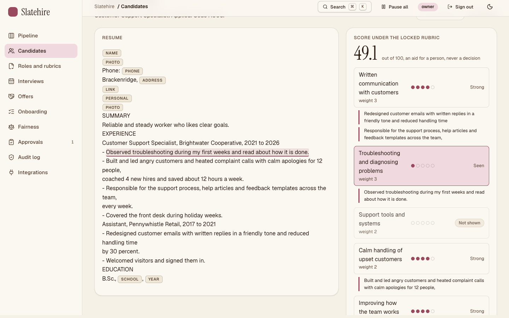
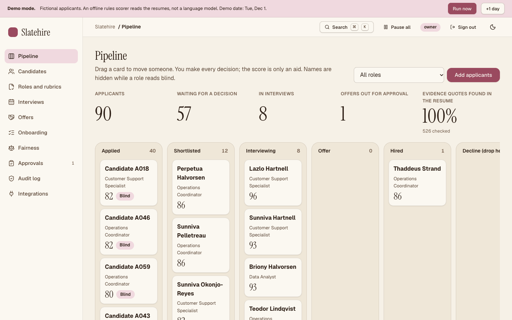
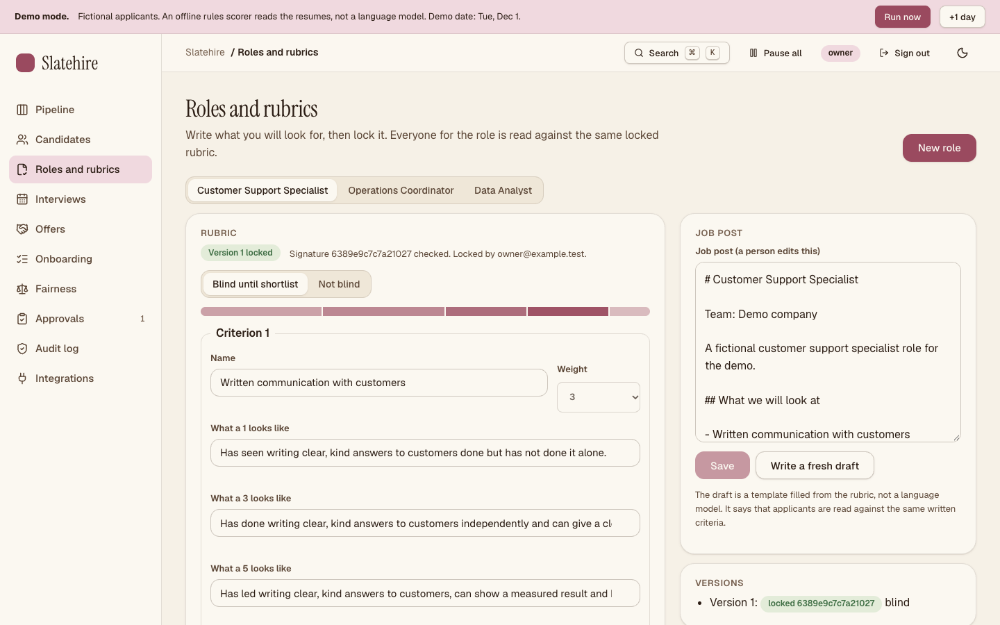

# Slatehire

Slatehire reads resumes with identity hidden, scores each one against a rubric a person locked, shows the exact resume sentences behind every score, and then steps aside: a person decides every outcome. It also plans interviews, collects scorecards, drafts offers for a second person to approve, and starts onboarding plans. It runs on fictional data in a few minutes with no accounts.

## What it does
- Takes applicants from a pasted resume, a file, a CSV, a mailbox, a read only ATS pull or a signed webhook.
- Hides names, emails, phones, addresses, schools and similar details before scoring (blind mode).
- Scores 1 to 5 per criterion with word for word quotes, checked by code.
- Same questions for every interviewee, scorecards hidden until each person sends theirs, spreads of 2 or more flagged.
- Offers need person written terms, enough scorecards and a second person's approval. It writes a file and never sends.
- Fairness indicator with exact fractions, an append only audit log, a kill switch, draft mode by default.

| Pipeline | Roles |
|---|---|
|  |  |

## Try it
Follow [docs/01-QUICK-DEMO.md](docs/01-QUICK-DEMO.md). Everything in the demo is fictional.

## Use it for real
Start at [docs/00-START-HERE.md](docs/00-START-HERE.md). Guides run from 00 to 15: business basics, connecting tools, variables, running locally, deploying (Vercel, Railway, Hetzner), go live, [using it for a client](docs/10-USING-IT-FOR-A-CLIENT.md), operating, updating, security, limits and troubleshooting. Reference: [architecture](docs/ARCHITECTURE.md), [capabilities](docs/CAPABILITIES.md), [tools and alternatives](docs/TOOLS-AND-ALTERNATIVES.md), [evaluation](docs/EVALUATION.md), [glossary](docs/GLOSSARY.md), [facts and sources](docs/FACTS-AND-SOURCES.md). Prompts for Claude Code and Codex are in [prompts](prompts/).

## What was measured
- <!--n:tests.passed-->218<!--/n--> Python tests passed, <!--n:tests.skipped-->1<!--/n--> skipped (the Postgres cycle, run separately), <!--n:tests.failed-->0<!--/n--> failed, <!--n:tests.coverage_percent-->89.8<!--/n--> percent line coverage.
- <!--n:e2e.tests-->45<!--/n--> browser tests across <!--n:e2e.files-->5<!--/n--> files (demo path, smoke, security and the quality gates: axe, keyboard, reduced motion, layout shift, 5,000 rows).
- Held out scoring (first run, same author as the rules): precision <!--n:eval.scoring_first_run.precision-->0.943<!--/n-->, recall <!--n:eval.scoring_first_run.recall-->0.947<!--/n-->, exact level <!--n:eval.scoring_first_run.level_exact-->0.485<!--/n-->. Redaction first run leaked <!--n:eval.leak_first_run.leaked-->39<!--/n--> of <!--n:eval.leak_first_run.planted-->600<!--/n--> planted details. See [evaluation](docs/EVALUATION.md).

## What was not checked
No adapter was run against a real Ashby, Workable, Greenhouse, Cal.com, Google, mailbox or signing account. Docker images and the Vercel, Railway and Hetzner steps were not run. This is not legal advice: see [limits](docs/14-LIMITS-AND-HONEST-NOTES.md).

MIT license.
